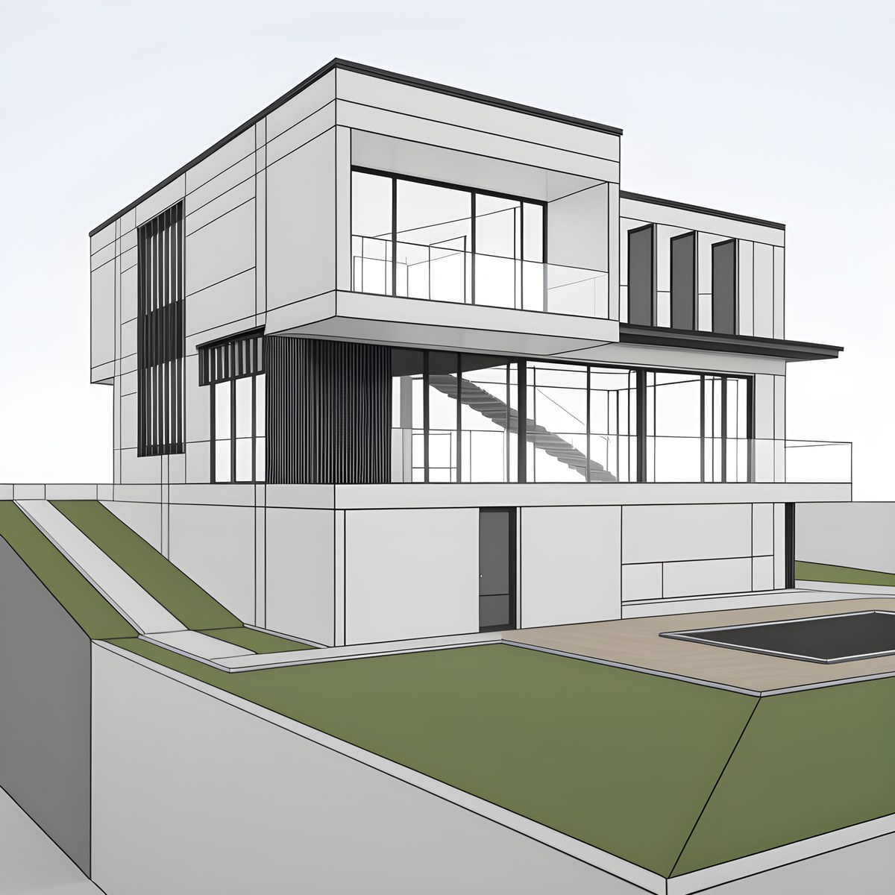
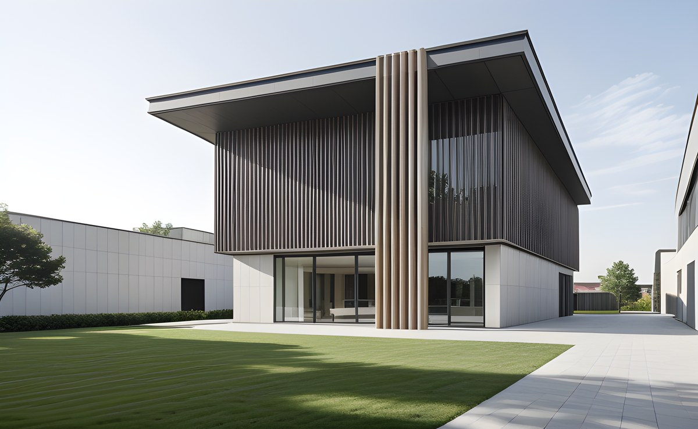

# Lite Bridge for IngeTrazo

Capture the IngeTrazo viewport and redraw it with a local Stable Diffusion 1.5 model through ComfyUI. One prompt, one size, one model: a free demo of the workflow.

For more control (material references, lighting looks, control maps, FLUX.2 Klein models and Nano Banana cloud rendering), see the commercial add-ons.

## Examples

Both show the Masaryk 118 house, design by Sergio Amaya, used with his permission. Results come from the free demo model.

## Requirements

- IngeTrazo 0.5.9 or later (the version this was tested with).
- ComfyUI running at `http://127.0.0.1:8188`.
- The checkpoint `realarchvis_sd15V2.safetensors` in `ComfyUI/models/checkpoints/` and the LoRA `lcm-lora-sdv1-5.safetensors` in `ComfyUI/models/loras/`. The plugin can download them for you. Optional: `RealESRGAN_x4plus.pth` in `ComfyUI/models/upscale_models/` for the 2x upscale.

## Install

Easiest: install it from the IngeTrazo catalog, under **Extensiones > Gestionar extensiones**.

Manual: download `ingetrazo_lite_bridge-0.1.0.zip` from the release page, unzip it, and copy the `lite_bridge` folder into your IngeTrazo plugins folder (**Extensiones > Abrir carpeta de complementos**). Restart IngeTrazo.

The full step-by-step guide is in [INSTALL.md](INSTALL.md).

## Use

1. Open **Extensions > Lite Bridge** and check the setup (test the connection, scan the ComfyUI folder).
2. Write the prompt, set the longest side, choose a proportion, and set how much to change (0.4 is the default).
3. Click **Capture and generate**. The result and its capture are saved to the output folder.

## Notes

- Stable Diffusion 1.5 is simpler than FLUX.2 Klein, so the results are less detailed.
- It doesn't use ControlNet: the layout follows the capture, so a high "how much to change" can drift from the view.
- Demo use: the models' licences allow commercial use of their outputs, but this plugin is a demo of the workflow.

## Licence

GPL-3.0-or-later. See [LICENSE](LICENSE).

The models are not included. The checkpoint and the LoRA are each under their own licence, set by their authors. Read the licence on each model page before you use them.
